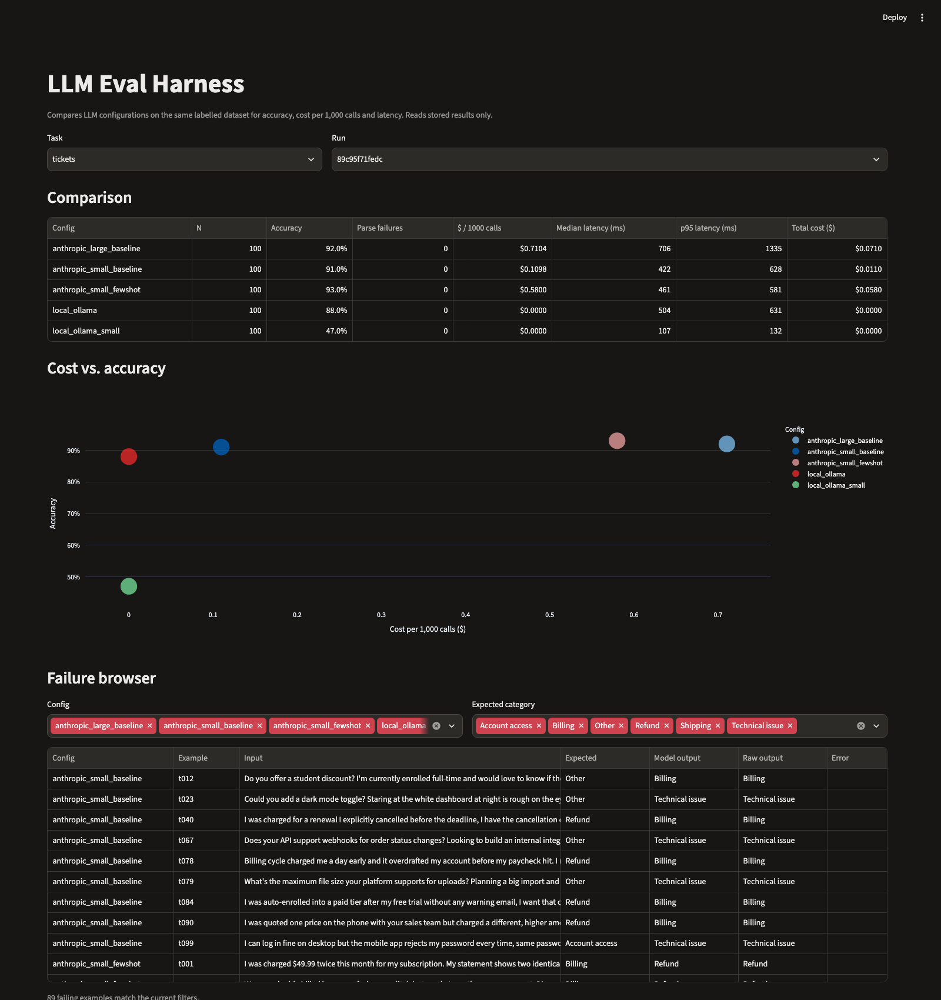

# LLM Eval Harness

Run a labelled test set through several LLM configurations and see which one
gives the best accuracy for the cost and latency — one command, reproducible,
with every failure inspectable.

## The problem

Teams pick models and prompts by trying a few examples by hand. That misses
regressions, hides cost differences of 10x or more, and gives no evidence
when someone asks "why this model?" This harness replaces hand-testing with a
repeatable pipeline: a versioned dataset, a runner that calls every config,
scorers that grade every output, and a dashboard that compares results side
by side.

## Results

*Run `evalh run --task tickets` with your own API key, then `evalh report
--task tickets`, and paste the table here. Placeholder below shows the shape
of the output — these are not real numbers.*

| Config | Accuracy | $ / 1,000 calls | Median latency | p95 latency |
|---|---|---|---|---|
| `large_baseline` | — | — | — | — |
| `small_baseline` | — | — | — | — |
| `small_fewshot` | — | — | — | — |

**Key finding:** *(fill in after a real run, e.g. "small_fewshot matches
large_baseline's accuracy within 2 points at roughly 1/5 the cost.")*


*(add a screenshot after your first run — see "Dashboard" below)*

## Quickstart

```bash
git clone <this-repo>
cd "LLM Comparison"
uv sync --extra dev --extra dashboard

cp .env.example .env
# edit .env and add OPENAI_API_KEY (the 3 launch configs all use OpenAI)

uv run evalh run --task tickets      # ~100 examples x 3 configs, < $1, < 5 min uncached
uv run evalh report --task tickets   # re-prints the summary table for the latest run
uv run evalh failures --task tickets --config small_baseline
```

Re-running `evalh run` reuses the cache (keyed on config + example) and costs
$0 and takes under 10 seconds, as long as the dataset and configs haven't
changed.

## Dashboard

```bash
uv run streamlit run dashboard/app.py
```

Opens a comparison table, a cost-vs-accuracy scatter plot, and a failure
browser filterable by config and expected category. The dashboard only reads
from the local `results.db` SQLite file — it never calls a model API, so it's
safe to host publicly (e.g. Streamlit Community Cloud) without exposing keys.

## The launch task

Support-ticket classification into 6 categories: Billing, Technical issue,
Account access, Shipping, Refund, Other. 100 examples, at least 15 per
category, with written [labelling guidelines](tasks/tickets/labeling_guidelines.md).
The tickets were LLM-drafted (varied tone and length) and reviewed against
those guidelines before being committed — they are not real customer data.
A few are deliberately ambiguous so the task doesn't trivially hit 95%+
accuracy for every config (see the PRD's risk section).

## Configurations at launch

| Config | Provider / model | Prompt |
|---|---|---|
| `large_baseline` | OpenAI `gpt-5` | baseline |
| `small_baseline` | OpenAI `gpt-5-mini` | baseline |
| `small_fewshot` | OpenAI `gpt-5-mini` | few-shot + label definitions |
| `local_ollama` (optional) | Ollama `llama3.1` | baseline |

Prices live in one file, [`prices.yaml`](prices.yaml), checked against public
pricing pages on **2026-11-15** — verify before trusting cost figures for a
real decision, since provider prices change without notice. The optional
Ollama config costs $0 but needs a local server running (`ollama pull
llama3.1`); it isn't auto-discovered by the default config glob, see
[`tasks/tickets/configs/optional/local_ollama.yaml`](tasks/tickets/configs/optional/local_ollama.yaml)
for how to include it.

## Adding a task or a config

- **New config:** drop a YAML file into `tasks/<task>/configs/` with
  `provider`, `model`, `prompt_file`, `temperature`, `max_tokens` — no code
  changes.
- **New task:** add `tasks/<new_task>/data.jsonl` (rows of `id`, `input`,
  `expected`, optional `notes`), at least one prompt file, and a
  `configs/` directory. If it's a classification task, the same
  parser/scorer apply as long as the prompt instructs the model to answer
  with one of the known labels — only the category list in
  `evalh/scoring/parser.py` needs updating per task today (see Roadmap).

## Architecture

A straight pipeline, each stage its own module so a new task, provider or
scorer slots in without touching the rest:

```
evalh/
  cli.py            typer commands: run, report, failures
  runner.py         asyncio + semaphore + tenacity retries, cache-aware
  store.py          SQLite: runs / configs / results / cache tables
  pricing.py        cost_usd() from prices.yaml
  reporting.py      accuracy / cost-per-1000 / median+p95 latency per config
  dataset.py        loads + validates tasks/<task>/data.jsonl, hashes it
  config.py         loads tasks/<task>/configs/*.yaml, hashes each config
  models.py         pydantic types shared across the pipeline
  providers/        openai.py, anthropic.py, ollama.py -- one shape out
  scoring/          parser.py (label extraction), scorers.py (exact-match)
tasks/tickets/      the launch task: data, prompts, configs, guidelines
dashboard/app.py    Streamlit + Plotly, reads SQLite only
prices.yaml
tests/
```

**Reproducibility:** every run records the dataset hash, each config's hash
(model + params + prompt text), the git commit, and a timestamp. Temperature
defaults to 0. Responses are cached on `(config_hash, example_id)`, so a
re-run with the same dataset and config is free and returns the same result.

**Reliability:** provider calls retry up to 3 times with exponential backoff;
a call that still fails is recorded as an error row (counted as wrong) rather
than stopping the run.

## Development

```bash
uv sync --extra dev --extra dashboard
uv run pytest -q
uv run ruff check .
```

CI (`.github/workflows/ci.yml`) runs both on every push/PR to `main`. Tests
cover the parser, scorer, dataset/config loaders, pricing and the runner
(against a fake provider — no real API calls run in CI).

## Roadmap (not yet built)

Per-class accuracy and confusion matrix, run-to-run diff (which examples
flipped right/wrong), a CI mode that fails below an accuracy threshold,
bootstrap confidence intervals, and a field-level/LLM-as-judge scorer for
non-classification tasks. See the PRD for the full P1/P2 list.

## Non-goals (v1)

Not a general-purpose eval platform, no user accounts/auth, no fine-tuning,
no multi-turn/agent evals, no real-time production monitoring.
